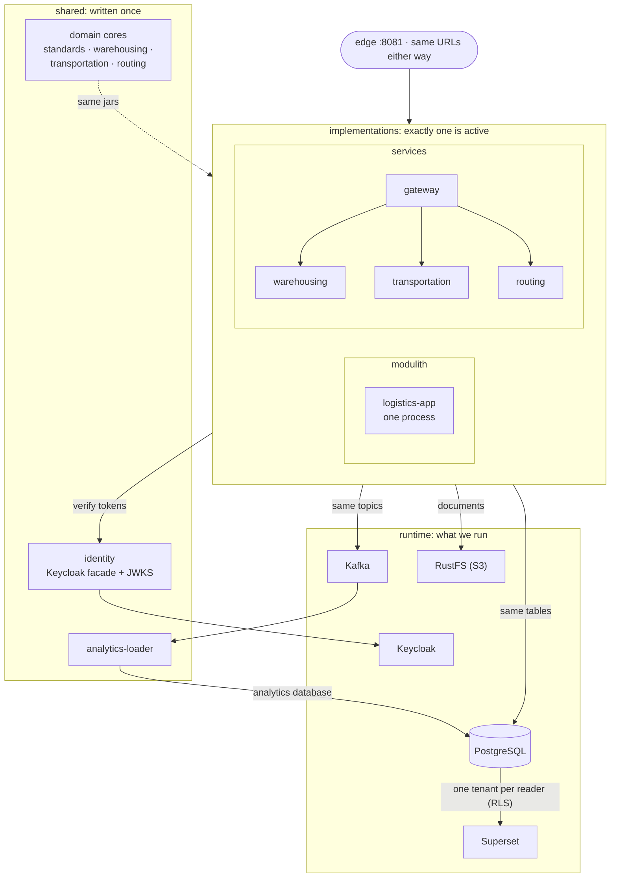
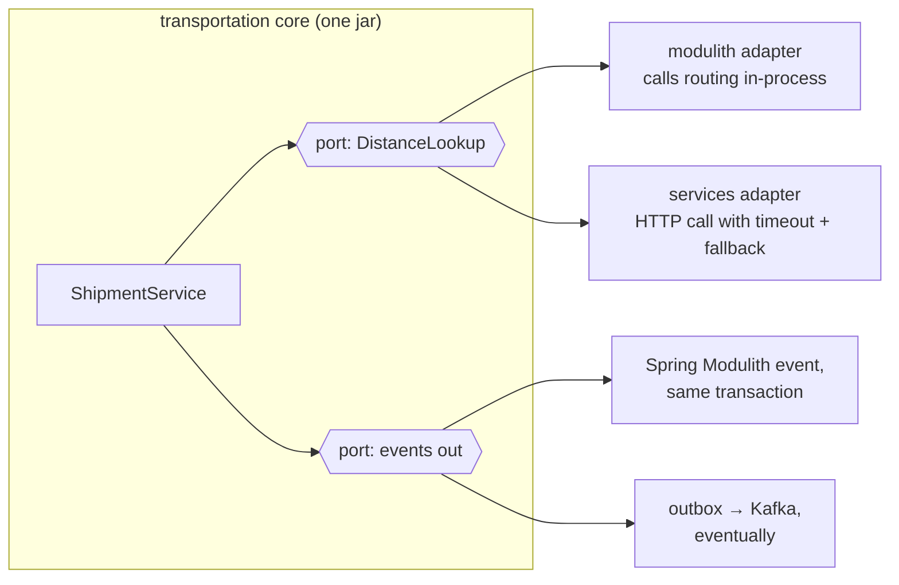
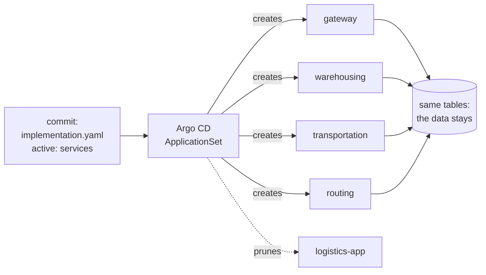
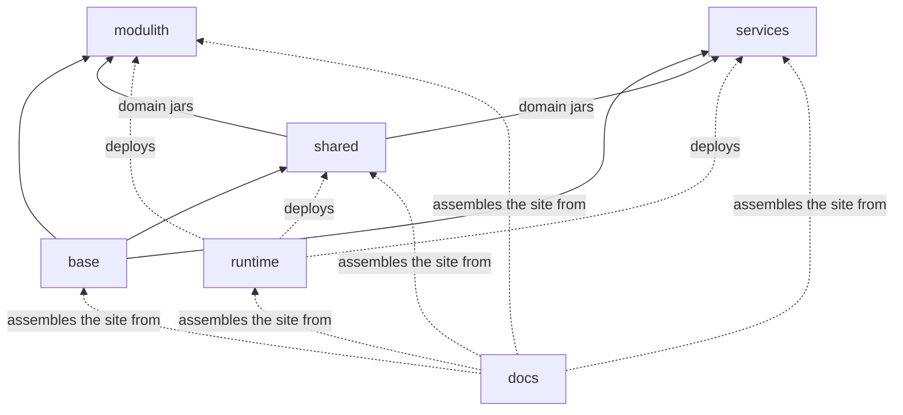

# FF Logistic

**One logistics product, built twice: as a modular monolith and as microservices, on the same platform, behind the same switch.**

Most "monolith vs. microservices" discussions compare a real system with an imagined one. This project builds both for real. The warehouse, transport and routing rules are written **once**. Only the wiring between them differs: in-process calls and events in one process, or REST and Kafka between three. Both run on the same Kubernetes platform, against the same database tables, Kafka topics and identity service. One Git commit decides which of the two is running.

That makes the comparison concrete. The same request, the same data and the same failure can be measured on both. The results go into a comparison guide, not into opinions.

> Status: **S6, events out**. The analytics loader reads delivered shipments from Kafka into a database of its own, locked to the tenant with row-level security and rolled up per month, exactly. The modulith now sends the same events to Kafka as the services, checked by one contract test in shared (`ff-contracts`): a delivery made on either side lands in the same table, and the loader cannot tell which side sent it. The plan is in [backlog.md](backlog.md); the documentation site is at [ffetih.github.io/ff-logistic-docs](https://ffetih.github.io/ff-logistic-docs/).

---

## The system



Whichever implementation is active reaches the platform the same way: the same tables, topics, object store and identity service.

| Layer | Rule | Contents |
| :--- | :--- | :--- |
| **runtime** | What we run but do not write | k3d cluster, Argo CD, Argo Rollouts, PostgreSQL, Keycloak, Kafka, RustFS, Superset, the service Helm chart |
| **shared** | Written once; does not care which implementation runs | Identity service, analytics loader, the domain cores |
| **modulith** / **services** | The same business, wired two ways | One Spring Modulith application / three Spring Boot services and a gateway |

## One core, two wirings

Each business area is a plain Java library: its entities, rules, Flyway migrations and REST API. Where it needs another area, it declares a **port**, an interface such as `DistanceLookup`. The two implementations differ only in who implements the ports:



So every difference you can measure comes from the wiring: one transaction versus eventual consistency, a method call versus a network hop, one deployment versus four. None of it comes from two diverging copies of the business rules.

## The switch



Both implementations use the same tables, so switching keeps the data. Each area owns its migrations and its own Flyway history table, whichever process runs them. The smoke test after a switch is the same test, against the same URLs.

## The business

A freight forwarder, multi-tenant, built from what real logistics systems do:

- **Warehousing**: warehouses and bins, advance shipping notices (ASN), receiving and palletizing, with GS1 identifiers (SSCC, GLN).
- **Transportation**: shipments over multimodal legs (road, rail, sea), the pickup → departure → delivery lifecycle, an electronic consignment note (e-CMR), and a CO2e footprint per leg (EN 16258 / ISO 14083), compared with road-only.
- **Routing**: delivery territories and route plans with time windows, optimized with Timefold over a road matrix (OSRM, or haversine as a fallback), with proof of delivery (e-POD).
- **Analytics**: deliveries streamed from Kafka into a separate database, locked to the tenant with PostgreSQL row-level security and rolled up per month, for Superset dashboards.

## Repositories

| Repository | What it holds |
| :--- | :--- |
| [ff-logistic-docs](https://github.com/ffetih/ff-logistic-docs) | This hub: the plan, architecture, decisions, comparison, the documentation site |
| [ff-logistic-runtime](https://github.com/ffetih/ff-logistic-runtime) | The cluster, Argo CD (app of apps), the platform, the Helm chart, the switch |
| [ff-logistic-base](https://github.com/ffetih/ff-logistic-base) | Technical libraries: BOM, parent POM, tenant, web, security, persistence, storage |
| [ff-logistic-shared](https://github.com/ffetih/ff-logistic-shared) | Identity service, analytics loader, the domain cores |
| [ff-logistic-modulith](https://github.com/ffetih/ff-logistic-modulith) | The modular monolith |
| [ff-logistic-services](https://github.com/ffetih/ff-logistic-services) | The microservices and their gateway |



## Stack

| Area | Choice |
| :--- | :--- |
| Language, framework | Java 25, Spring Boot 4.1, Spring Modulith 2.1 |
| Data | PostgreSQL 17, Flyway, Hibernate; row-level security for analytics |
| Messaging | Apache Kafka 4.2 (KRaft) between the services; a transactional outbox in every process (Spring Modulith's event publication registry), delivering in-process inside the modulith |
| Identity | Keycloak behind a small identity facade; services verify JWTs locally against its JWKS |
| Optimization | Timefold Solver, OSRM |
| Objects | RustFS (S3 API), presigned write-once links |
| Delivery | k3d, Argo CD (app of apps, ApplicationSet), Argo Rollouts canary with analysis, Helm, Kustomize |
| CI | GitHub Actions, images on GHCR |
| Docs | AsciiDoc, Antora, Mermaid and PlantUML diagrams |

## Running it

Everything runs on one local k3d cluster in WSL; nothing is applied by hand except the cluster and Argo CD itself. Start with the [Cluster Guide](https://github.com/ffetih/ff-logistic-runtime/blob/main/docs/modules/ROOT/pages/cluster-guide.adoc) in `ff-logistic-runtime`.

```bash
k3d cluster create --config deploy/cluster/k3d-config.yaml     # in ff-logistic-runtime
kubectl apply -k deploy/argocd --server-side --force-conflicts
# Argo CD UI: http://127.0.0.1:8080
```

## How it is built

In sprints, one pull request per sprint and one commit per backlog item; each sprint ends with something running on the cluster. An earlier single-repository version (`ff-devops-logistic-app`, sprints S0–S8) is the reference the code is ported from, with its later fixes folded in where the code first appears.
