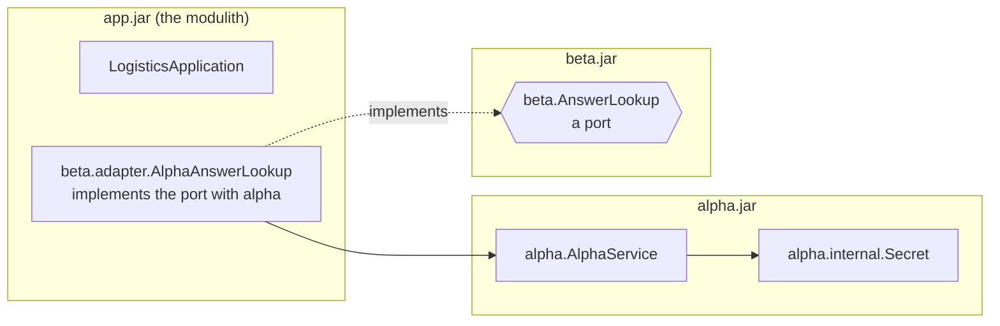

# Spike: does Spring Modulith verify modules that come from jars?

Decision 2 puts each business area in a jar of its own (ff-logistic-shared), and the modulith assembles them. That only works if Spring Modulith still finds those modules, and still enforces its rules on them, when their classes are not in the application's own source tree. This spike answers that before anything depends on it (S01-01).



`alpha` and `beta` are jars, as the domain cores will be. The application jar holds the adapter, in **beta's package** (`com.siose.ff.logistics.beta.adapter`): the same package split over two jars, as the modulith's adapters will be.

## Result (Spring Modulith 2.1.1, Spring Boot 4.1.2, Java 25)

| Case | Expected | Got | What `verify()` says |
| :--- | :---: | :---: | :--- |
| Clean | pass | pass | Modules `alpha` and `beta` found; the adapter counts as part of `beta`; `beta` → `alpha` |
| (a) The adapter calls `alpha.internal.Secret` | fail | fail | Module 'beta' depends on non-exposed type …alpha.internal.Secret within module 'alpha' |
| (b) `beta` no longer lists `alpha` in `allowedDependencies` | fail | fail | Module 'beta' depends on module 'alpha' via …AlphaAnswerLookup → …AlphaService. Allowed targets: none. |
| (c) Code under `alpha`'s package uses `beta` | fail | fail | Cycle detected: Slice alpha → … |

So, for the design:

- **Modules are found by package, not by where the class file lives.** The cores can be jars.
- **`package-info.java` inside a jar is honoured**, and so is the line between a module's API (its top package) and its internals (sub-packages).
- **An adapter belongs to the module whose package it is in**, even when it sits in the modulith's jar. Its calls are checked like the module's own.

Two guards, at two times, keep a core clean:

| Guard | When | Stops |
| :--- | :--- | :--- |
| Maven: a core's pom depends on `standards` only | compile time | A core using another core at all |
| Spring Modulith: `allowedDependencies`, exposed types, no cycles | the modulith's tests | An adapter using another area other than through its API, or a cycle |

A core's `allowedDependencies` therefore lists what its module may use **in the modulith**, adapters included (for transportation: `standards` and `routing`); Maven makes sure the core's own code uses none of it.

## Run it

```bash
./run.sh      # needs ff-base-parent in ~/.m2 (ff-logistic-base: ./build.sh) and JDK 25
```
